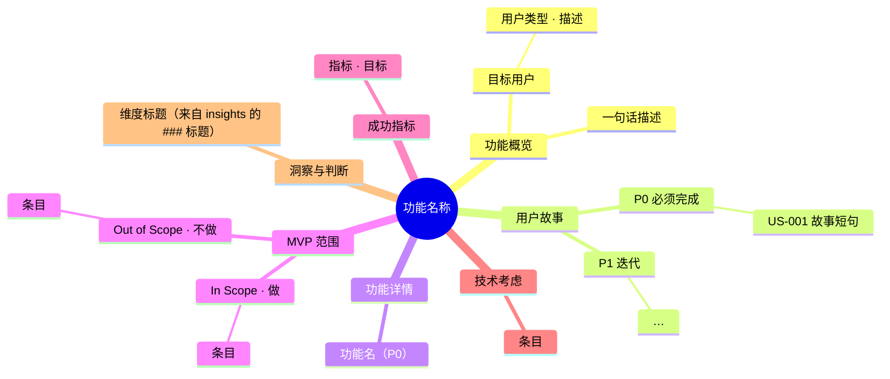
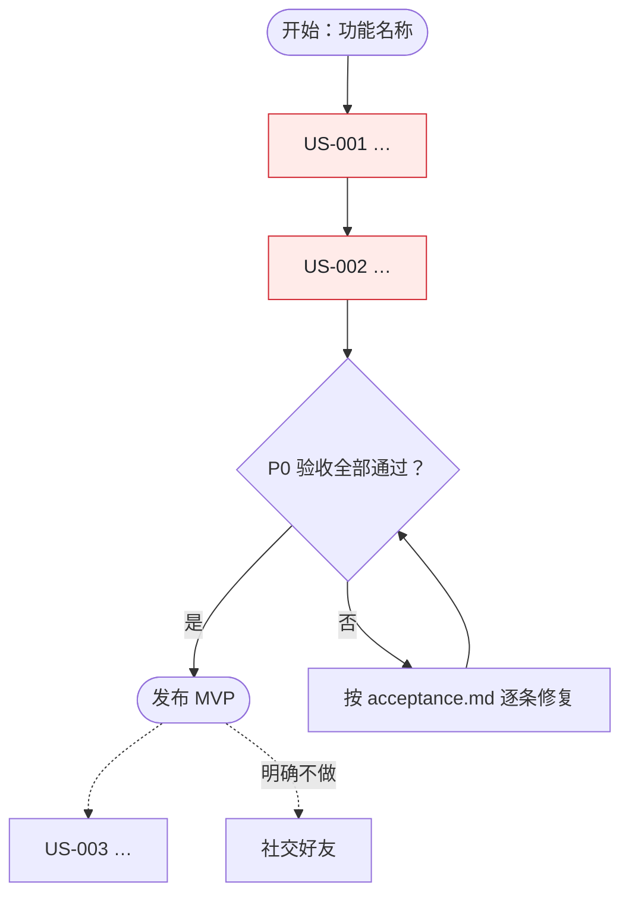

# Mermaid 导出（mindmap.mmd / flowchart.mmd）

`prd_write` 会从 `prd` 对象**确定性地**生成两张 Mermaid 图，不需要你手写：

| 文件 | 内容 | 来源 |
| --- | --- | --- |
| `mindmap.mmd` | PRD 结构思维导图 | name / summary / target_users / user_stories（按优先级分组）/ features / scope / metrics / tech / insights 的维度标题 |
| `flowchart.mmd` | 用户流程图 | P0 故事主线 → 「P0 验收全部通过？」判断 → 发布 MVP；P1/P2 用虚线表示后续迭代；`out_of_scope` 用虚线标注「明确不做」 |

## 你可以做什么

- 想调整图的内容 → **改 `prd` 对象**（例如某个故事表达更短、优先级调整、范围变化），重新 `prd_write` 覆盖生成；
- 用户想看渲染效果 → 让用户把 `.mmd` 文件内容贴到 [Mermaid Live Editor](https://mermaid.live/) 预览，或直接在支持 Mermaid 的编辑器里打开；
- 用户要 PNG/SVG → Mermaid Live Editor 可导出；本插件不做图片渲染（零运行时依赖、无网络）。

## 渲染环境

大部分 Markdown 工具原生支持 Mermaid：

- ✅ GitHub / GitLab
- ✅ Obsidian
- ✅ Notion
- ✅ VS Code（Mermaid 插件）
- ✅ 飞书文档

## 生成规则（排查问题用）

`mindmap.mmd` 结构：

`flowchart.mmd` 结构：

说明：

- 节点文本会去掉 Mermaid 语法字符（`()`、`[]`、引号等），因此**故事短句更利于阅读**——写 `story` 时不必为了图而刻意缩短，图会自动截断；
- 没有 P0 故事时不会出现验收 Gate（正常 PRD 不应出现这种情况，`prd_check` 会报错）；
- `out_of_scope` 最多画 5 个节点，多的折叠为「等 N 项（见 prd.md 第 7 章）」。

## 完整导出包

默认（`formats` 不传）一次生成：

| 文件 | 说明 |
| --- | --- |
| `prd.md` | 完整 PRD（Markdown，9 章） |
| `prd.json` | 结构化 JSON（Ralph 兼容） |
| `acceptance.md` | P0/P1/P2 验收勾选清单 |
| `mindmap.mmd` | Mermaid 思维导图 |
| `flowchart.mmd` | Mermaid 用户流程图 |

用户只要其中几种时，调用 `prd_write` 并传 `formats: ["md", "json"]` 之类即可（可选值：`md` / `json` / `acceptance` / `mindmap` / `flowchart`）。
